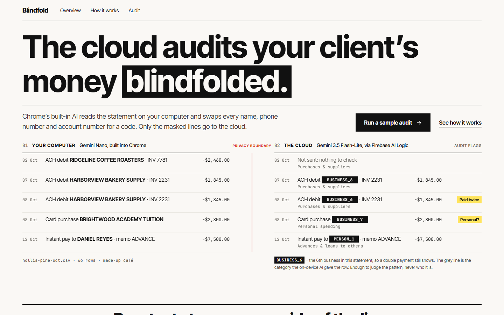
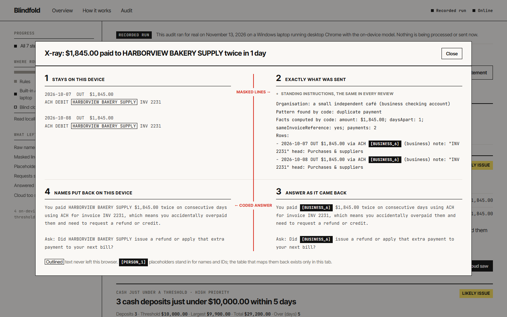
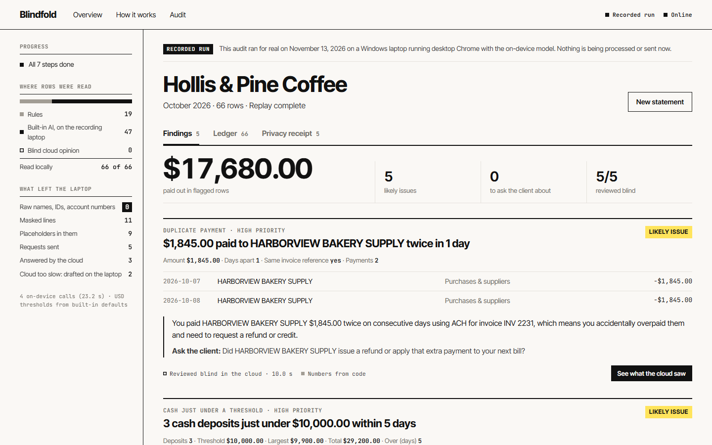

# Blindfold

**The cloud audits your client's money, blindfolded.**

Blindfold is a second pair of eyes for bank statements, built for one-person bookkeeping practices, volunteer treasurers and small nonprofits. Chrome's built-in AI reads the raw statement on your computer and swaps every name, phone number and account number for a code. Plain code finds the patterns an auditor looks for and does every sum. Only masked lines go to a larger cloud model, through Firebase AI Logic, for a blind review. The answers come back in codes, the names are put back on your computer, and every word that left is listed on a privacy receipt.

**Live app:** https://blindfold-audit.web.app &nbsp;·&nbsp; **Demo video:** https://youtu.be/UWM-k9jvhVc &nbsp;·&nbsp; **License:** Apache-2.0



## Try it

Open **https://blindfold-audit.web.app**, choose **Audit**, and pick a sample statement. Every person and business in the samples is fictional, and no sign-up is needed.

- **With Chrome's built-in AI** (desktop Chrome 139 or newer on [supported hardware](https://developer.chrome.com/docs/ai/get-started)): choose **Run on this computer**. The first time, Chrome downloads the model once (about 4 GB); the app asks before starting that download, and its status line shows whether the model is ready.
- **Without it:** choose **Watch a recorded run** to replay a real audit recorded on a laptop that has the built-in model (always labelled as a recording), or choose **Run on this computer** and accept the **masked cloud-only mode**. In that mode rows are masked by rules on your computer first, and the cloud labels the masked lines.
- **Your own statement:** drop a CSV export from your bank. The date, description and amount columns are worked out from the file, with or without a header row (US, UK, European and Indian layouts; see [Reading real bank exports](#reading-real-bank-exports)). The app shows how it read the file before the audit starts, and if it cannot tell the columns apart, you point at them. The file is read in the browser tab and never uploaded.

## The problem

Someone has to check the books of a homeowners' association, a small charity or a one-person business, and often that someone is a volunteer treasurer or a solo bookkeeper working without audit software. They are expected to catch double payments, money that quietly comes back, and cash deposits kept just under a reporting limit. A cloud AI model would help, but pasting a client's bank statement into one hands names, account numbers and spending habits to a third party.

The cloud does not need to know who anyone is to judge a pattern. So Blindfold splits the work at a privacy boundary: everything that needs names stays on the computer, and the cloud only ever sees codes, amounts, dates and a few everyday words.

## How it works

| Step | Runs on | Firebase AI Logic | What happens |
|---|---|---|---|
| 1. Rules | Your computer | none | Obvious rows (ATM, interest, bank charges, tax, rent, utilities, wages, own-account transfers) are labelled by plain rules and never meet a model. |
| 2. Label every payee | Your computer | `ONLY_ON_DEVICE` | Gemini Nano, built into Chrome, reads each remaining payee once and picks a category from a fixed list (structured output with `responseConstraint`). Raw text may only meet the built-in model: with no model the call fails, it never falls back to the cloud. |
| 3. Find patterns | Your computer | none | Deterministic code finds double payments, round trips (money out and back from a related party), cash just under a reporting limit, payments split under an approval limit, personal spending and unusual amounts. The AI never calculates. |
| 4. Mask and re-check | Your computer | `ONLY_ON_DEVICE` | Every payee becomes a numbered code (`BUSINESS_6` is the 6th business in the statement, so a double payment still shows). In a note, a word that is not on an everyday-word list is masked too, and so is a number that could be the tail of a card or an account. Gemini Nano then re-reads everything about to leave as a leak guard, and plain code searches each request for the statement's own words before it is sent. |
| 5. Blind review | The cloud | `PREFER_IN_CLOUD` | Gemini 3.5 Flash-Lite judges each finding from the masked lines and drafts a question for the client (structured output with `responseSchema`). Rows the built-in model was unsure about get a blind second opinion the same way. If the cloud call fails (for example, the laptop is offline) or does not answer within 25 seconds, the built-in model answers instead, and the answer is labelled as an on-device draft with an "Ask the cloud again" button. |
| 6. Names back | Your computer | none | The codes in each answer are replaced with the real names, and the privacy receipt lists every request word for word. |

Firebase also provides **App Check** (reCAPTCHA Enterprise on the hosted site, enforced for Firebase AI Logic, so only this app can call the cloud model), **Remote Config** (reporting limits, approval limits, model names and how many cloud requests one audit may use, changeable without a redeploy) and **Hosting**.

No step is a single point of failure. If the built-in model returns a broken answer, those payees get a blind second opinion instead of stopping the audit. If the cloud fails, the findings (which come from code) still appear, each with a "Try again" button for its review.

### What actually leaves the computer

A real example from the recorded run of the café sample:

| | |
|---|---|
| Raw line, stays on the computer | `2026-10-08  ACH DEBIT HARBORVIEW BAKERY SUPPLY INV 2231  -1,845.00` |
| The line as sent | `2026-10-08 OUT $1,845.00 via ACH [BUSINESS_6] (business) note: "INV 2231" category: Purchases & suppliers` |
| The cloud's question | `Did [BUSINESS_6] confirm this second payment of $1,845.00 was a mistake and agree to refund it?` |
| For the client | `Did HARBORVIEW BAKERY SUPPLY confirm this second payment of $1,845.00 was a mistake and agree to refund it?` |

Rows that need no second look are never sent at all. The X-ray view shows all four steps for any finding, with your computer on the left of the red line and the cloud on the right:



## Privacy safeguards

Layered so that a single miss does not leak a name:

1. **Unmasked text never reaches the cloud.** Raw rows are read only by the built-in model, through `ONLY_ON_DEVICE`, which fails rather than falling back. In the masked cloud-only mode for browsers without the built-in model, rows are masked by rules on the computer before anything is sent.
2. **A payee is never sent as text.** Every party in the statement (a person, a business, a bank, a tax office, the client's own other account) is registered in statement order and replaced by a stable code. The cloud learns what kind of party it is and nothing else. The table that turns codes back into names exists only in the open browser tab.
3. **Default-deny notes.** In free-text notes, only everyday words, dates and document numbers survive. Anything else becomes a placeholder: a first name or a place (`[WORD_n]`), and any number that is not plainly a count, a year or an invoice number, so the last four digits of a card or an account never leave.
4. **Pattern masks** for phone numbers, emails, card, account and ID numbers.
5. **An on-device leak guard** re-reads every outgoing line and masks anything that still looks like a name. It catches what rules cannot know: that "June" in a note is a child and not a month.
6. **A last check before sending, by exact match.** The app keeps a list of every word and number in the raw statement that is not an everyday word. Each request is searched for all of them. Anything found is masked on the spot; if something is still readable after that, the request is stopped and never sent. This check knows nothing about how the masking works, so a bug in the masking cannot hide from it ([`src/engine/proof.ts`](src/engine/proof.ts)).
7. **A receipt that is measured, not asserted.** The receipt's first number ("raw names, IDs or account numbers sent") is that same search, run again in the browser whenever the receipt is drawn, including for the recorded runs. It shows how many words and numbers it looked for and how many it found. The receipt also lists every request word for word and can be printed or downloaded as JSON.

## Results on the sample statements

The three samples are made-up organisations with problems planted for the audit to find. These numbers are from the recorded runs that ship with the app ([`public/recorded`](public/recorded)), made on a Windows laptop running desktop Chrome with the built-in model. Run `node tools/check-recorded.mjs` to reproduce the checks.

| Sample | Rows | Labelled by rules | Labelled on device | Requests sent | Raw identifiers sent | Categories correct |
|---|---|---|---|---|---|---|
| Hollis & Pine Coffee (café) | 66 | 19 | 47 | 5 | 0 | 64 / 66 |
| Willow Creek Homeowners Association | 45 | 29 | 16 | 4 | 0 | 45 / 45 |
| Maple Street Animal Rescue | 34 | 25 | 9 | 5 | 0 | 31 / 34 |

- **Leak check:** every request was searched for every word and number of its statement that is not an everyday word (74, 44 and 38 of them). None appeared. The app repeats this search in your browser each time a recorded run is replayed, and `npm test` repeats it too.
- **Reviews:** 13 of the 14 reviews were answered by the cloud; one fell back to an on-device draft when the cloud took longer than the deadline.
- **Errors:** three cheques to a vet clinic were labelled as purchases rather than services, an office-supply shop as bank charges, and a jewellery purchase as an own-account transfer rather than personal spending. On-device labels can vary a little from run to run.



### A test on statements the app had never seen

After the prompts were final, three more made-up statements were written with an answer key for every row ([`eval/holdout`](eval/holdout), generated by [`tools/gen-holdout.mjs`](tools/gen-holdout.mjs)): a dental practice, a youth soccer club and a freelance designer. None of their payees appear in the samples or in the prompt's examples. Each was audited once on the same laptop; the full results are in [`eval/holdout/results-2026-11-13.json`](eval/holdout/results-2026-11-13.json).

| Statement | Rows | Categories correct | Rows labelled by the on-device model, correct | Planted problems found | Raw identifiers sent |
|---|---|---|---|---|---|
| Dental practice | 36 | 30 | 18 of 22 | 2 of 2, plus 1 false alarm | 0 |
| Youth soccer club | 36 | 28 | 7 of 14 | 2 of 3 | 0 |
| Freelance designer | 23 | 23 | 16 of 16 | 2 of 2 | 0 |
| **Total** | **95** | **81 (85%)** | **41 of 52 (79%)** | **6 of 7** | **0 in 7 requests** |

- **The on-device model's misses** were plausible confusions: a sports-field rental read as a service, a website subscription as a purchase, fuel as a utility, a country club as rent.
- **The missed problem:** a loan repaid after 18 days, outside the 10-day round-trip window (adjustable in Remote Config).
- **The false alarm:** a payment to a dental supplier and a deposit from a dental insurer, of similar amounts, were paired as money going out and coming back, because both names contain "DENTAL". The round-trip check now links two parties only through a person's surname or a business's brand word. A person's "paid back" was also booked as dues; repayment wording is now recognised. Both fixes have tests, but they were made after seeing these statements, so the numbers above are from before the fixes.
- **Run again after the fixes** (same laptop, same day; no longer an unseen test, so read it as a regression check): 83 of 95 categories correct, 43 of 55 on-device labels correct, the same 6 of 7 planted problems found, no false alarm, and nothing from the statements in any of the 6 requests.

### Reading real bank exports

The samples above were written for the app, so they say nothing about whether a real bank's file loads. [`eval/formats`](eval/formats) holds made-up statements in the layouts that real banks export, and [`src/engine/formats.test.ts`](src/engine/formats.test.ts) checks each one:

| Layout | What the importer has to get right |
|---|---|
| One signed amount column and a "Type" column | "Type" holds bank codes, not debit or credit, so the sign decides. A "Details" column sits next to "Description". |
| A summary block above the table | The table starts further down; dates are month-first; amounts are in quotes. |
| No header row | The columns are told apart by what is in them. |
| Separate debit and credit columns | Day-first dates; sort code and account number columns to ignore. |
| Withdrawal and deposit columns | The currency is in the header; UPI and NEFT narrations. |
| Dates written out, or with a time | "Nov 3, 2026", "4 November 2026", "11/05/2026 10:22"; a negative amount in brackets. |
| Semicolons and a decimal comma | "1.250,00" is one thousand two hundred and fifty. |

An ambiguous date such as 03/04/2026 is settled by the rest of the column (a 13 can only be a day) and otherwise by the currency. Wording used by large US banks is parsed for the payee (person-to-person transfers, card purchases with a store number and city, ACH lines with an originator, wires, transfers to the client's own savings account). Anything the parser does not recognise is still safe: the whole payee text becomes one code.

The same privacy test runs over all of these files as well as the samples: every row is masked as if it were about to be sent, and the result is searched for every word and number of the statement ([`src/engine/privacy.test.ts`](src/engine/privacy.test.ts)).

## Firebase AI Logic in the code

The two model kinds, condensed from [`src/lib/firebase.ts`](src/lib/firebase.ts), and the on-device call from [`src/engine/ondevice.ts`](src/engine/ondevice.ts):

```ts
import { getAI, getGenerativeModel, GoogleAIBackend, InferenceMode } from 'firebase/ai';

export const ai = getAI(firebaseApp, { backend: new GoogleAIBackend() });

// Raw statement text only ever goes here: if the built-in model is missing, the SDK throws.
export function deviceModel(promptOptions) {
  return getGenerativeModel(ai, { mode: InferenceMode.ONLY_ON_DEVICE, onDeviceParams: { promptOptions } });
}

// Masked text only: the cloud first, the built-in model as the safety net after a deadline.
export function cloudFirstModel(inCloudParams, promptOptions, timeoutMs = 25_000) {
  return getGenerativeModel(
    ai,
    { mode: InferenceMode.PREFER_IN_CLOUD, inCloudParams, onDeviceParams: { promptOptions } },
    { timeout: timeoutMs },
  );
}

// Labelling a batch of payees on the device, with a structured answer per line:
const model = deviceModel({ responseConstraint: { type: 'object', properties: props, required: Object.keys(props) } });
const res = await model.generateContent(prompt);
const where = res.response.inferenceSource; // 'on_device', shown in the app and the receipt
```

| File | What it does |
|---|---|
| [`src/lib/firebase.ts`](src/lib/firebase.ts) | `getAI` with the Gemini Developer API backend, App Check, and the model factories: `deviceModel` (`ONLY_ON_DEVICE`) and `cloudFirstModel` (`PREFER_IN_CLOUD` with a per-call timeout). |
| [`src/lib/device.ts`](src/lib/device.ts) | Checks whether the built-in model is available and calls `initializeDeviceModel` (from a button click) to download it, with progress. |
| [`src/engine/ondevice.ts`](src/engine/ondevice.ts) | `categoriseOnDevice` (payee labelling in batches, with a keyed enum constraint) and `leakGuard` (re-reads outgoing text). |
| [`src/engine/cloud.ts`](src/engine/cloud.ts) | Builds the masked requests, `cloudFirst` (cloud with deadline, on-device fallback, records `inferenceSource`), `reviewFinding` and `runSecondOpinion`. |
| [`src/engine/pipeline.ts`](src/engine/pipeline.ts) | Runs one audit end to end, applies the last check before anything is sent, and records every outgoing request word for word in the privacy ledger. Carries on when a model call fails. |
| [`src/engine/proof.ts`](src/engine/proof.ts) | Lists every word and number of the raw statement that must stay on the computer, and searches outgoing requests for them: before sending, and again for the receipt. |
| [`src/engine/vault.ts`](src/engine/vault.ts) | The code vault: payees to codes, default-deny masking of notes, and the codes back to names. |
| [`src/lib/remoteConfig.ts`](src/lib/remoteConfig.ts) | Limits and model names from Remote Config, with built-in defaults. |

Other folders: `src/engine` also holds the CSV import ([`csv.ts`](src/engine/csv.ts)), narration parsing, rules, detectors and the everyday-word list; `src/ui` is the React interface; `tools/` has the sample and held-out generators, the recorded-run checker and the screenshot script; `eval/holdout` holds the unseen test statements and their results, and `eval/formats` the bank export layouts; `lab.html` with `src/lab/` is a small internal page used early on to time on-device labelling and is not part of the app.

`npm test` runs 45 checks without a browser or a network: the parser and detectors, the bank export layouts, the privacy tests (nothing from any statement appears in its masked lines; the recorded runs pass the receipt's search), and whole audits with stand-in models in both modes, including a model that returns a broken answer, a leak guard that cannot run and a cloud that is out of quota ([`src/engine/pipeline.test.ts`](src/engine/pipeline.test.ts)).

## Run it yourself

Requirements: Node.js 22 or newer, a Firebase project on the free Spark plan, and desktop Chrome for the on-device model.

```bash
git clone https://github.com/Automationbot24x7/blindfold.git
cd blindfold
npm install
cp .env.example .env.local   # then fill in your Firebase web app config
npm run dev                  # http://localhost:5173
npm test                     # engine tests
npm run build                # production build in dist/
```

Firebase setup:

1. Create a Firebase project and add a web app. Put its config in `.env.local` (see [`.env.example`](.env.example)).
2. In **Firebase AI Logic**, enable the Gemini Developer API.
3. In **App Check**, register a debug token for local development and put it in `.env.development.local` as `VITE_APPCHECK_DEBUG_TOKEN`. For a hosted site, create a reCAPTCHA Enterprise key for your domain, register it for the web app, and put the site key in `.env.production` as `VITE_RECAPTCHA_SITE_KEY`.
4. Optional: in **Remote Config**, override `cloud_model`, `device_batch_size`, `duplicate_window_days`, `round_trip_window_days`, the limits per currency such as `cash_threshold_usd` and `approval_limit_usd`, or how much of the cloud quota one audit may use (`max_label_requests`, `max_reviews`). Defaults are built in.
5. Deploy with `firebase deploy --only hosting`, after pointing [`.firebaserc`](.firebaserc) at your own project and site.

To record a new replay, open `http://localhost:5173/?record=1#/audit` in Chrome with the built-in model and run a sample; the development server saves the run to `public/recorded/`.

## Limits

- Statements must be CSV exports (not PDF or spreadsheet files), up to 3,000 transactions. Descriptions are expected in English; a description in another language is still masked, as one code, but its payee and purpose are not picked apart.
- A file with a single unsigned amount column and nothing that says debit or credit (some card statements) cannot be read correctly; the app says so when it sees one.
- Masking is rule-based with an on-device check and an exact-match search before sending. It is designed to fail closed, but no masking is perfect, which is why the receipt shows every word that left. The search can only find what is written in the statement: amounts and dates are sent as they are, by design.
- In the masked cloud-only mode the cloud never sees a payee's name, so its category labels are rougher than the built-in model's. The findings come from code and are the same in both modes.
- One audit asks the cloud to label at most 180 payees and reviews at most 12 findings automatically (the cloud model runs on a shared free quota); the rest wait for a click.
- On-device labelling varies slightly between runs and takes longer the first time the model loads.
- Flags are prompts for questions to the client, not an accounting or legal opinion.

## Built with

React, Vite and TypeScript; the Firebase JavaScript SDK (AI Logic, App Check, Remote Config) and Firebase Hosting; Papa Parse for CSV; one icon from Lucide; the Inter Tight, Inter and JetBrains Mono fonts via Fontsource. The sample statements and their answer keys are generated by [`tools/gen-samples.mjs`](tools/gen-samples.mjs).

## License

[Apache License 2.0](LICENSE)
